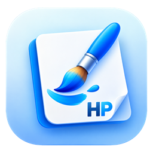

<p align="center">
  
</p>

<h1 align="center">HarshPaint</h1>

<p align="center">
  <b>The paint app you already know, rebuilt from scratch in Rust — with superpowers.</b><br>
  Layers · Kaleidoscope symmetry · Smooth strokes · Pixel art · Time-lapse GIFs<br>
  One small app. No installer, no account, no telemetry. Windows, macOS and Linux.
</p>

<p align="center">
  <a href="https://github.com/hvpathak/HarshPaint/actions/workflows/ci.yml"></a>
  
  
  
  
</p>

<p align="center">
  <a href="#download"><b>⬇ Download</b></a> ·
  <a href="#signature-features">✨ Features</a> ·
  <a href="#fast-measured">⚡ Speed</a> ·
  <a href="#the-cli">🤖 CLI</a> ·
  <a href="#build-from-source">🛠 Build</a>
</p>

<p align="center">
  
  <br><sub>36 strokes, 12-way kaleidoscope. This GIF was exported by HarshPaint itself (<code>File → Export time-lapse GIF</code>).</sub>
</p>

---

## Signature features

<table>
  <tr>
    <td width="50%" valign="top">
      <h3>🔮 Symmetry &amp; kaleidoscope</h3>
      Paint once, get up to <b>24 mirrored copies</b> live: mirror left/right, top/bottom, four-way,
      radial ×6/×8, and kaleidoscope ×6/×8/×12. Guides show the axes; ghost cursors show where every
      copy will land. Works with brushes, pencil, spray, eraser and <i>every shape</i>.
    </td>
    <td width="50%" valign="top">
      <h3>🗂️ Real layers</h3>
      Add, duplicate, reorder, hide, merge down, and set opacity. Save as <code>.hpaint</code> to keep
      every layer, or export a flat PNG, JPEG, BMP or GIF.
    </td>
  </tr>
  <tr>
    <td valign="top">
      <h3>✍️ Smooth-stroke stabilizer</h3>
      A "lazy rope" between your mouse and the pen: wobbles never reach the canvas. Handwriting and
      line art come out clean, from 0% (raw) to 100% (glass-smooth).
    </td>
    <td valign="top">
      <h3>👾 Pixel-art mode</h3>
      One switch (<kbd>Ctrl+Shift+P</kbd>): crisp aliased pixels, a pixel grid when you zoom in, and
      nearest-neighbour scaling so sprites stay sharp.
    </td>
  </tr>
  <tr>
    <td valign="top">
      <h3>🎞️ Time-lapse GIF</h3>
      Every stroke is recorded. Export your whole drawing session as a looping GIF in one click, ready to share.
    </td>
    <td valign="top">
      <h3>⌨️ Command palette</h3>
      <kbd>Ctrl+K</kbd> and type: "kaleido 12", "flip", "new layer"… every action in the app, one keystroke away.
    </td>
  </tr>
</table>

<p align="center">
  
</p>

## Everything you expect from a paint app

| | |
|---|---|
| **Draw** | Pencil, brush (size + hardness), eraser, spray, 12 shapes (line, rectangle, rounded rectangle, oval, triangles, diamond, pentagon, hexagon, arrow, star, heart) with outline / fill / both, text with your system fonts |
| **Colour** | Colour 1 (left click) and colour 2 (right click), swap with <kbd>X</kbd>, the classic 20-colour palette, a full colour picker, eyedropper |
| **Fill** | Flood fill with tolerance; <kbd>Shift</kbd>+click fills **every** matching pixel in the picture |
| **Tricks** | Right-drag with the eraser **replaces colour 1 with colour 2** and leaves everything else alone |
| **Select** | Rectangle select, move, cut / copy / paste (system clipboard), delete, crop to selection, transparent selection |
| **Image** | Resize (keep aspect), canvas size, rotate 90° / 180°, flip, invert colours, all undoable |
| **View** | Zoom 12.5% → 3200% (<kbd>Ctrl</kbd>+wheel), pan (middle button or <kbd>Space</kbd>+drag), fit, gridlines, full screen |
| **Files** | PNG, JPEG, BMP, GIF and layered `.hpaint`; drag and drop to open; atomic saves |

Familiar shortcuts: <kbd>Ctrl+N/O/S</kbd>, <kbd>F12</kbd> Save as, <kbd>Ctrl+Z/Y</kbd>, <kbd>Ctrl+W</kbd> Resize,
<kbd>Ctrl+E</kbd> Canvas size, <kbd>Ctrl+Shift+X</kbd> Crop, <kbd>Ctrl+Shift+I</kbd> Invert, <kbd>Ctrl+G</kbd> Gridlines,
<kbd>Ctrl+PgUp/PgDn</kbd> Zoom, <kbd>Ctrl++/−</kbd> Brush size, <kbd>F11</kbd> Full screen.
Plus one-key tools: <kbd>B</kbd> brush, <kbd>P</kbd> pencil, <kbd>E</kbd> eraser, <kbd>F</kbd> fill, <kbd>I</kbd> picker,
<kbd>T</kbd> text, <kbd>S</kbd> select, <kbd>L</kbd> line, <kbd>R</kbd> rectangle, <kbd>O</kbd> oval.

## Fast, measured

Measured on a mid-range laptop (i5-13450HX), release build, a **12-megapixel** (4000 × 3000) picture:

| Operation | Time |
|---|---|
| Window open (warm start) | **31 ms** |
| Fill the whole picture | 111 ms |
| A 1,000-point brush stroke | 47 ms |
| The same stroke with **×24 kaleidoscope** | 519 ms |
| Undo that stroke | **4 ms** |
| Encode to PNG | 55 ms |

Run it yourself: `harshpaint-cli bench`.

## Built to never lose your work

- **No crashes by design.** `unwrap`, `panic!`, raw indexing and `unsafe` are banned by the compiler in all
  app code. Every damaged file or odd input becomes a message, never a crash.
- **Atomic saves.** HarshPaint writes a temporary file and swaps it in, so a full disk or power cut can't
  leave you with half a picture.
- **Bounded memory.** Undo history keeps only the pixels each stroke changed, with a memory budget.
  Files over 16,384 px per side or 100 MP are refused politely, not allocated.

## Download

| Platform | Download | Notes |
|---|---|---|
| **Windows** 10 / 11 (x64) | [HarshPaint-windows-x64.exe](https://github.com/hvpathak/HarshPaint/releases/latest/download/HarshPaint-windows-x64.exe) | One file, double-click. If SmartScreen warns, choose **More info → Run anyway**. |
| **macOS** 11+ (Apple Silicon **and** Intel) | [HarshPaint-macos-universal.zip](https://github.com/hvpathak/HarshPaint/releases/latest/download/HarshPaint-macos-universal.zip) | Unzip, drag to Applications. First launch: right-click → **Open**. |
| **Linux** x64 | [HarshPaint-linux-x64.tar.gz](https://github.com/hvpathak/HarshPaint/releases/latest/download/HarshPaint-linux-x64.tar.gz) | Unpack and run `./harshpaint`. Needs GTK 3 (on most desktops already). |

Command-line tool: [Windows](https://github.com/hvpathak/HarshPaint/releases/latest/download/harshpaint-cli-windows-x64.exe) ·
[macOS](https://github.com/hvpathak/HarshPaint/releases/latest/download/harshpaint-cli-macos-universal.zip) · Linux (inside the tarball).

## The CLI

The same engine without a window, for scripts and AI agents:

```text
harshpaint-cli demo mandala.png timelapse.gif    # paint a kaleidoscope and its time-lapse
harshpaint-cli resize photo.jpg small.png 800x600
harshpaint-cli rotate scan.png upright.png 90
harshpaint-cli convert art.hpaint art.png        # flatten layers
harshpaint-cli commands                          # every command, menu and shortcut
harshpaint-cli bench                             # the numbers above
```

## Build from source

```sh
git clone https://github.com/hvpathak/HarshPaint
cd HarshPaint
cargo run --release -p harshpaint
cargo test --workspace
```

Rust 1.88+. On Linux, install GTK 3 and xkbcommon headers first
(`sudo apt install libgtk-3-dev libxkbcommon-dev libxcb-render0-dev libxcb-shape0-dev libxcb-xfixes0-dev`).

## How it's built

```text
crates/core          the engine: canvas, layers, brushes, symmetry, stabilizer, fill, shapes, text,
                     selection, undo, file formats, time-lapse, command catalog. No UI code at all.
apps/harshpaint      the desktop app: a thin egui shell that draws the engine's state
apps/harshpaint-cli  the same engine from the command line
```

- **Everything is a command.** Menus, shortcuts, the command palette and the CLI all read one catalog.
- **Coverage masks, not stamps.** Each stroke draws "how much of each pixel is covered" and keeps the maximum,
  so soft edges never darken where dabs overlap and symmetric copies never double up.
- **Clean-room.** Behaviour, labels and shortcuts were studied from the paint app installed on a Windows PC
  (with the [REA](https://github.com/morluto/rea) reverse-engineering toolkit). No code, icons or assets were copied.
- **70 tests** cover every tool, undo round trips, file round trips and malformed files.

## Roadmap

Free-form selection · selection scaling · more brushes (calligraphy, marker, watercolour) · layer thumbnails
and blend modes · rulers · print · colour emoji in text · code signing.

Ideas and pull requests are welcome. The house rules: no `unwrap`/`panic`/`unsafe` outside tests,
and every change comes with a test.

## License

[MIT](LICENSE). HarshPaint is an independent project.
